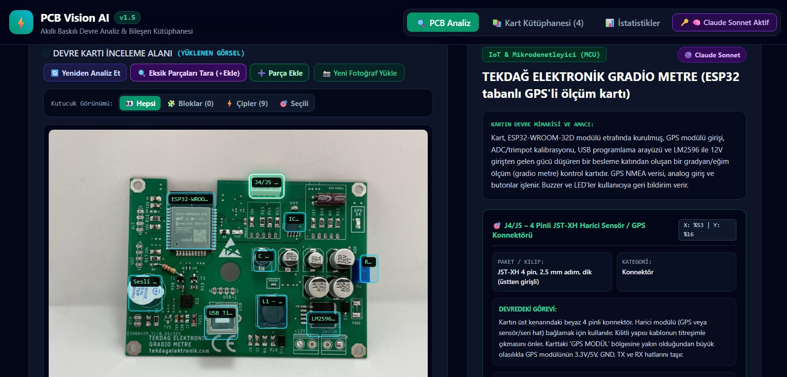

# Akıllı PCB Analiz ve Bileşen Tanıma Aracı (PCB Vision AI) ⚡

Bu proje, **Yapay Zeka Mesleki Gelişim Programı "Web Geliştirme; Yapay Zeka Proje Yönergesi"** gereksinimlerine ve standartlarına tam uyumlu olarak geliştirilmiş modern, yapay zeka destekli bir web uygulamasıdır.

Klasik bir TODO uygulaması yerine; kullanıcıların Baskılı Devre Kartı (PCB) fotoğraflarını yükleyerek üzerindeki elektronik bileşenleri (MCU, regülatörler, indüktörler, kondansatörler, USB portu, sensör/GPS soketleri vb.) optik olarak analiz etmelerini, interaktif sınır kutucuklarıyla (Bounding Box) incelemelerini ve kartları **Kişisel PCB Kütüphanesi** üzerinde tam CRUD döngüsüyle yönetmelerini sağlar.



---

## 🚀 Öne Çıkan Özellikler

### 1. Çift Yapay Zeka (Dual-AI) & Optik Devre Analizi
* **Google Gemini & Anthropic Claude Entegrasyonu:** Kullanıcılar kendi API anahtarlarıyla ister ultra hızlı **Claude Haiku (~2-3 sn)** veya **Gemini Flash**, ister derin mühendislik analizi sunan **Claude Sonnet** modellerini seçebilir.
* **Parça Parça (Bileşen Bileşen) Hassas Ayrıştırma:** Kart üzerindeki çipler, modüller ve portlar tüm fotoğraf tuvaline göre normalize edilmiş koordinatlarla (`bbox`) tam sınırlarıyla işaretlenir.
* **Fonksiyonel Devre Blokları:** Devre üzerindeki mantıksal katlar (örn: Güç Katı, Giriş Klemensleri, Çıkış Sürücüleri) blok blok renkli olarak taranır ve açıklamayla eşleştirilir.
* **Gelişmiş Görünüm Filtresi (Toggle):** *Tümünü Göster*, *Yalnızca Devre Blokları*, *Yalnızca Çipler* veya *Yalnızca Seçili Öğe* modları arasında anlık geçiş.
* **Tek Tıkla Yeniden Analiz:** Fotoğrafı baştan yüklemeden farklı yapay zekalarla tek tıkla tekrar analiz edebilme.

### 2. Yönergeye Tam Uyumlu CRUD Döngüsü
* **Ekle (Create):** Yapay zeka analizinden doğrudan aktarılan veya modal form ile manuel eklenen kartlar.
* **Listele (Read):** Kayıtlı kartların görsel panoda listelenmesi, anlık arama, kategori filtreleme ve detay modalı.
* **İnteraktif İnceleme:** Kütüphanedeki herhangi bir karta tıklandığında doğrudan analiz ekranına geçip tüm çiplerini interaktif kutucuklarla inceleyebilme.
* **Güncelle (Update):** Kayıtlı kartın başlığını, amacını, kategorisini, etiketlerini ve özel kullanıcı notlarını düzenleme.
* **Sil (Delete):** Yanlışlıkla silinmeyi engelleyen onay pencereli güvenli silme mekanizması.

### 3. Veri Depolama & Güvenlik (LocalStorage)
* Tüm kartlar ve API ayarları tarayıcının yerel hafızasında (`localStorage`) güvenle saklanır; sayfa yenilense bile silinmez.
* **JSON Export / Import:** Kütüphane verilerini tek tıkla JSON olarak bilgisayara indirme ve geri yükleme.
* **ErrorBoundary (Çökme Kalkanı):** Hatalı veri durumunda sayfanın çökmesini önleyen ve tek tıkla sıfırlama sunan hata yakalayıcı.

### 4. İstatistik & Özet Paneli
* Toplam kart sayısı, kütüphanedeki toplam bileşen sayısı ve sistem depolama durumu.

---

## 🛠️ Teknoloji Yığını (Tech Stack)

* **Frontend Kütüphanesi:** React 18 (Component mimarisi, Hooks: `useState`, `useEffect`, `useMemo`)
* **Stil & Arayüz:** Tailwind CSS (Karanlık laboratuvar teması, fütüristik grid deseni, tamamen duyarlı / responsive)
* **Veri Kalıcılığı:** HTML5 LocalStorage API
* **Yapay Zeka Servisi:** Google Gemini API (`v1beta`) & Anthropic Claude API (`v1/messages`)
* **Geliştirme & Derleme:** Vite 5 & PostCSS

---

## 📂 Dizin Yapısı (Modüler Mimari)

```text
pcb-analyzer/
├── public/                 # Statik varlıklar (screenshot, _redirects vb.)
│   ├── _redirects          # Netlify SPA yönlendirme kuralı
│   └── screenshot.jpg      # Uygulama önizleme görseli
├── src/
│   ├── components/         # Tekrar kullanılabilir arayüz bileşenleri
│   ├── interfaces/         # Veri şeması ve tipleri
│   ├── services/           # LocalStorage CRUD ve Yapay Zeka analiz servisleri
│   │   ├── storageService.js       # CRUD ve LocalStorage yönetimi
│   │   └── imageAnalysisEngine.js  # Gemini & Claude Vision AI motoru
│   ├── data/               # Başlangıç hazır demo kart veritabanı (mockPcbData.js)
│   ├── App.jsx             # Ana bileşen, router ve durum yönetimi
│   ├── main.jsx            # React başlangıç noktası
│   └── index.css           # Tailwind stilleri ve özel animasyonlar
├── index.html              # HTML ana şablonu
├── package.json            # Bağımlılıklar ve npm scriptleri
├── vite.config.js          # Vite yapılandırması
├── tailwind.config.js      # Tailwind CSS yapılandırması
└── README.md               # Proje dokümantasyonu
```

---

## 💻 Kurulum ve Çalıştırma (Lokal)

1. Proje klasörüne girin:
   ```bash
   cd pcb-analyzer
   ```
2. Bağımlılıkları yükleyin:
   ```bash
   npm install
   ```
3. Geliştirme sunucusunu başlatın:
   ```bash
   npm run dev
   ```
4. Tarayıcınızda açın: `http://localhost:3000`

---

## 🌐 Netlify Üzerinden Canlı Yayına Alma

 Kodları GitHub hesabınızda **public** bir depoya yükleyin (`git push`).
2. [Netlify](https://www.netlify.com)'ye giriş yapıp **"Add new site" -> "Import an existing project"** butonuna tıklayın.
3. GitHub deponuzu seçin.
4. Ayarları şu şekilde onaylayın:
   * **Build Command:** `npm run build`
   * **Publish directory:** `dist`
5. **Deploy Site** butonuna tıklayın. Birkaç saniye içinde canlı URL'iniz aktif olacaktır!1.

### 🔗 Canlı Demo
🚀 **Uygulamayı Test Edin:** (https://pcbvisionanalyzer.netlify.app)
